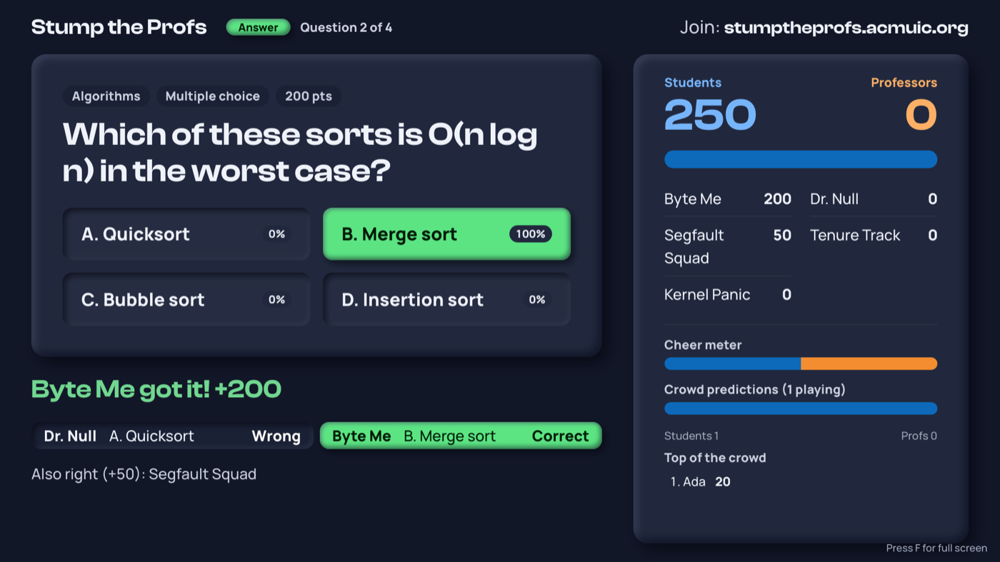

# Stump the Profs

A live trivia game for ACM at UIC, where student teams play against professor teams. Each team answers from its own laptop, the questions and scores show on a projector, and the audience plays along on their phones.

It runs at **https://stumptheprofs.acmuic.org**.



## Guides

Pick the one for you:

| Guide | For | What is in it |
|---|---|---|
| [How to play](docs/players.md) | Teams and the audience | Joining, answering, buzzing, what the big button means, and playing along on a phone. |
| [Running the event](docs/run-the-event.md) | Hosts and volunteers on the night | Checklist, host keys, each stage of a question, and what to do when something goes wrong. |
| [Before the event](docs/before-the-event.md) | Organizers | Writing and uploading questions and pictures, music, the admin key, and rehearsing. No coding. |
| [How the code works](docs/developers.md) | Developers | The architecture, how a buzz travels through the code, where things are, and how to change and deploy it. |
| [Frequently asked questions](docs/faq.md) | Everyone | Short answers to common questions, with links to the guides above. |

## How a question works

1. The host shows a question on every screen.
2. The host opens answers and a clock starts. Each team picks an answer and presses **BUZZ**. This locks the answer in, sealed, so only the host can see it.
3. Nobody says anything until answers close.
4. The host reads the sealed answers one by one. The fastest team goes first; after that it switches between Students and Professors. Each team says its answer out loud when it comes up.
5. The first right answer gets full points. Every other right answer gets a quarter.

Because every answer is sealed before anyone speaks, no team can copy another.

Questions can show a picture. A multiple choice question can have several right answers ("pick all that apply"): every right choice scores as a right answer, some of them with no wrong ones scores a small share, and any wrong choice scores nothing.

| Type | First right answer | Any other right answer |
|---|---|---|
| Free response | 300 | 75 |
| Multiple choice | 200 | 50 |
| True / false | 100 | 25 |

## The pages

| Page | For |
|---|---|
| `/` | Everyone: links to the team and audience pages. |
| `/player.html` | Each team's laptop: answer pad, buzzer, score and stats. |
| `/display.html?projector` | The projector: question, timer, answers, scores and the crowd. Also plays the music. |
| `/display.html` | The audience's phones: predict, answer along and cheer. |
| `/admin.html` | The host. Needs the admin key. |

## Try it on your computer

You need [Node.js](https://nodejs.org) 24.

```
npm install
cp .env.example .env    # then put a password after ADMIN_KEY=
npm run dev
```

Open `http://localhost:3000`. Run the automatic checks with `npm test`. The [developer guide](docs/developers.md#run-it-on-your-computer) has the details.

## Good to know

- **The real questions are not in this repo.** It is public, so the answers would be too. Questions and their pictures are uploaded on the host page; see [Write the questions](docs/before-the-event.md#write-the-questions).
- **Every push to `main` goes live** after a restart in Argo CD (ACM's deploy dashboard). Do not push on event day.
- Built with Node.js, Express and Socket.IO (a library for live two-way messages between the server and browsers). The game is saved to disk after every change, so a restart does not lose it.
