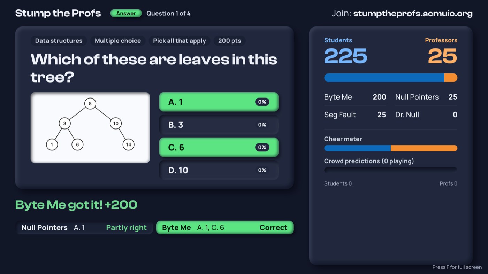

# Preparing Stump the Profs before the event

This guide is for the organizers getting the game ready: writing and uploading questions, adding pictures, choosing music, managing the admin key, and rehearsing. No coding needed. For the night itself, see [Running the event](run-the-event.md); for changing the code, see [How the code works](developers.md).

## Words used in this guide

- **JSON:** a plain text format with brackets and quotes. The questions file is JSON.
- **Cluster:** ACM's group of servers that runs the live site.
- **Argo CD:** ACM's deploy dashboard at `https://cd.acmuic.org`. It shows whether the site is healthy and has a **Restart** button.
- **Vault:** ACM's password store at `https://vault.acmuic.org`. It only opens on the ACM or Maid Café Wi-Fi.
- **Admin key:** the password for the host page. It lives in Vault.

## How it fits together

- The site runs on ACM's cluster. One server holds the whole game and saves it after every change, so a restart picks up where it left off.
- Questions are **not** stored with the code. The code is public on GitHub, so the answers would be public too. You upload the questions (and any pictures) on the host page instead, and the server keeps them.
- The admin key is kept in Vault, never written down in the code.

How it all works under the hood is in the [developer guide](developers.md).

## Write the questions

Questions go in one file, a JSON file (a plain text format with brackets and quotes). Each question is one block inside a list. Use [`questions.sample.json`](../questions.sample.json) as a starting point.

```json
[
  {
    "id": "cpu-1",
    "type": "free",
    "category": "Hardware",
    "prompt": "What does the C in CPU stand for?",
    "answer": "Central",
    "accept": ["central processing"],
    "seconds": 40
  },
  {
    "id": "sort-1",
    "type": "mc",
    "category": "Algorithms",
    "prompt": "Which of these sorts is O(n log n) in the worst case?",
    "choices": ["Quicksort", "Merge sort", "Bubble sort", "Insertion sort"],
    "answer": 1,
    "music": "https://youtu.be/VIDEO_ID?t=1m23s&end=2m10s"
  },
  {
    "id": "py-1",
    "type": "tf",
    "prompt": "Python lists are immutable.",
    "answer": false,
    "points": 150
  },
  {
    "id": "tree-1",
    "type": "mc",
    "prompt": "Which of these are leaves in this tree?",
    "image": "binary-tree.png",
    "imageAlt": "A binary search tree with 8 at the top",
    "choices": ["1", "3", "6", "10"],
    "answer": [0, 2]
  }
]
```

| Field | Needed? | What to put |
|---|---|---|
| `id` | Yes | A short name, different for every question. |
| `type` | Yes | `free` (typed answer), `mc` (multiple choice) or `tf` (true or false). |
| `prompt` | Yes | The question. |
| `answer` | Yes | `free`: the answer as text. `mc`: the number of the right choice, **counting from 0** (so `1` means the second choice). For more than one right choice, a list such as `[0, 2]`; see [More than one right answer](#more-than-one-right-answer). `tf`: `true` or `false`, without quotes. |
| `choices` | `mc` only | A list of 2 to 6 choices. They show as A, B, C and so on. |
| `category` | No | A label shown above the question, like `"Networking"`. |
| `points` | No | Points for the first right answer. Default: 300 free, 200 mc, 100 tf. |
| `seconds` | No | How long teams have to answer, from 5 to 300. Default: 30 free, 20 mc, 15 tf. |
| `accept` | `free` only | Other spellings that count as right automatically. Anything else waits for the host to judge. Capital letters and spaces at the ends are ignored. |
| `music` | No | A YouTube link that plays while this question is on screen. See [Music](#music). |
| `image` | No | A picture shown under the question: the file name of an uploaded picture, or an `https://` link. See [Pictures](#pictures). |
| `imageAlt` | No | A short description of the picture, read aloud by screen readers. Default: "Picture for this question". |

Tips:

- Free-response answers that do not exactly match `answer` or `accept` are judged by the host on the night. Add common spellings to `accept` to save time.
- If the file has a mistake, the upload is refused with a message that names the question and the problem, like `Question 4 (id "sort-1"): mc answer must be a choice number from 0 to 3`.
- **Never put the questions file on GitHub.** Keep it on your computer or in a private shared drive. (Developers: the `data/` folder is never committed, so `data/questions.json` is safe.)
- To test a file, upload it on the live site before the event, play a question or two, then click **Export backup** and **Reset game…**. Your questions stay loaded.

## More than one right answer

For a multiple choice question with several right choices, write `answer` as a list. `"answer": [0, 2]` means the first and third choices (A and C). Every screen then says **Pick all that apply**, and teams can select several choices before they press BUZZ.

How it scores, for a 200-point question whose right choices are A and C:

| A team locks in | Result | Points |
|---|---|---|
| A and C | **Correct.** Like any right answer: the first one read wins 200 and ends the question; any later one gets 50. | 200 or 50 |
| Only A | **Partly right.** The question does not end, so another team can still win it. The team gets the "also right" points (50) times the share of right choices it found (1 of 2). | 25 |
| A and B | **Wrong.** Any wrong choice means no points, even with a right one. | 0 |



- Partly right points are added when the question ends.
- With 3 right choices, finding 2 earns two thirds of the "also right" points (33 on a 200-point question).
- The audience still taps one choice on their phones. Any of the right choices counts for them.

## Pictures

Any question can show a picture under the prompt, such as a diagram, a chart or a screenshot of code. It shows on the projector, the team laptops and the phones. There are two ways to add one.

**Upload it (best).** Put the picture's file name in the question, like `"image": "binary-tree.png"`. Then upload the file on the host page (see the next section). Uploaded pictures stay hidden until their question is shown, so nobody can look ahead.

**Link to it.** Put a full `https://` link in `image`. The picture then lives on another website, where anyone can see it at any time. Do not link a picture that gives away an answer. A plain `http://` link is refused, because browsers block those on a secure site.

Rules for uploaded pictures:

- PNG, JPEG, GIF or WebP, up to 5 MB each. SVG is refused, for safety.
- File names may only use letters, numbers, `-`, `_` and `.`. No spaces. The name in `image` must match the file exactly, including capital letters.
- Uploading a picture with the same name replaces the old one.
- Pictures are **not** included in **Export backup**. Keep your own copies.

Tips for pictures people can read:

- On the projector a picture takes about a third of the screen's height, beside the choices. Use big text and thick lines.
- Wide pictures fit best.
- See-through backgrounds are shown on white, so dark lines on a see-through background work well.

## Put the questions on the live site

1. Open `https://stumptheprofs.acmuic.org/admin.html` and log in.
2. Click **Upload questions…** and choose your file.
3. You should see "Loaded N questions from …". The **Questions** list updates.
4. If any question has a picture, click **Upload pictures…** and choose all of them at once. You should see "Uploaded …".
5. Check the **Questions** list. A question with a picture says "(picture)". If it says "(picture missing: upload …)" in red, upload that file; check that the name matches exactly.

Uploading questions only works before the first question is shown. Pictures can be uploaded at any time. After a rehearsal, click **Export backup**, then **Reset game…**, then upload. The uploaded file is kept on the server, so a restart or a reset keeps it.

## Music

The projector plays music through YouTube. The host controls it from the **Music** box on the host page.

- **Background music:** paste a YouTube link (one video or a playlist), click **Set**, then **Play**. It loops.
- **A theme for one question:** add a `music` link to that question in the questions file. It plays while that question is on screen. Afterwards the background music picks up where it left off.
- **Start and stop times:** add `t=` for the start and `end=` for the stop. Both take seconds (`90`), minutes and seconds (`1m30s`), or clock style (`1:30`). Example: `https://youtu.be/VIDEO_ID?t=1m23s&end=2m10s`. A theme loops between the two.

Things to check before the night:

- **Some videos refuse to play outside YouTube.** Their owners turned off embedding. The host page shows "Projector: That video's owner does not allow it to play on other sites" when that happens. Test every link on the live site before the event: show that question with the projector page open, and listen.
- The projector computer needs internet access to YouTube.
- Browsers stay silent until someone clicks once on the projector page.

## Changes to the game itself

Code changes, changing the default points or clocks, and putting a new version live are covered in the [developer guide](developers.md). To change the points or clock for a single question, use `points` and `seconds` in the questions file instead; that needs no code change.

**Nobody should push code changes on event day.** The live site always runs the newest code, so a change could appear in the middle of the game.

## Change the admin key

1. Join the ACM or Maid Café Wi-Fi and open `https://vault.acmuic.org/ui/vault/auth?with=ldap`. Log in with your ACM account.
2. Open **kv**, then **stump-the-profs**, then **Create new version**.
3. Change the value of `ADMIN_KEY` and save.
4. Wait a minute, then **Restart** the `stump` deployment in Argo CD. The app only reads the key when it starts.
5. Share the new key privately with the hosts. Their browsers will ask for it again.

## Rehearse

Do a full practice run on the live site at least a day before. Use 3 or more laptops as teams, the real projector and a few phones.

- [ ] Every team can join, and you can rejoin one on a different laptop with its rejoin code.
- [ ] One question of each type plays through: lock in, read out, judge, reveal.
- [ ] If you have "pick all that apply" questions, play one with a complete pick, a partial pick and a pick with a wrong choice. Check the points.
- [ ] Every picture shows on the projector and can be read from the back of the room.
- [ ] Every question with a `music` link plays on the projector.
- [ ] **Restart test:** in the middle of a question, click **Restart** in Argo CD. Within a minute everything comes back where it was.
- [ ] **Idle test:** leave a team laptop on `player.html` for 15 minutes without touching it. The top right should stay "Connected". (The projector hides this line.) If it keeps dropping to "Reconnecting…", tell the SysAdmins; the cluster may be closing quiet connections.
- [ ] After the last question, **F** shows the final results on the projector, the laptops and a phone. Press **Z** to go back.
- [ ] Afterwards: **Export backup**, **Reset game…**, and check the real questions are loaded.

## Known issues

- **The site does not open on the ACM or Maid Café Wi-Fi.** Those networks use ACM's own address book (DNS), which has no entry for `stumptheprofs.acmuic.org`. A SysAdmin needs to add one pointing to the same place as `umpf.acmuic.org`. Until then, use UIC Wi-Fi or phone data. This may also stop the security certificate from renewing in December.
