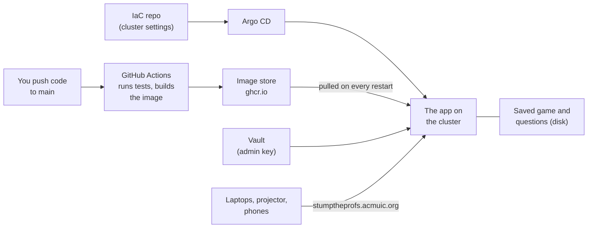
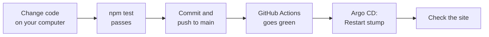

# Preparing Stump the Profs before the event

This guide is for the people getting the game ready: writing questions, testing, and changing or updating the site. For the night itself, see [Running the event](run-the-event.md).

## Words used in this guide

- **Repo (repository):** the folder of code stored on GitHub. This one is `acm-uic/Stump-The-Profs-Website`.
- **`main`:** the main version of the code in the repo. Whatever is on `main` is what the live site runs.
- **Commit and push:** saving a change in git (commit), then sending it to GitHub (push).
- **Terminal:** the text window where you type commands (Terminal on a Mac).
- **Container image:** the app packed into one file that a server can run. GitHub builds a new one each time you push to `main`.
- **GitHub Actions:** GitHub's robot that runs the tests and builds the image after every push.
- **Cluster:** ACM's group of servers that runs the live site. It uses Kubernetes, a system that starts apps and restarts them if they crash.
- **Pod:** one running copy of the app on the cluster.
- **Argo CD:** ACM's deploy dashboard at `https://cd.acmuic.org`. It shows whether the app is healthy and has a **Restart** button.
- **IaC repo:** `acm-uic/IaC`, the repo that describes everything ACM runs on the cluster. Changing the cluster means a pull request there.
- **Vault:** ACM's password store at `https://vault.acmuic.org`. It only opens on the ACM or Maid Café Wi-Fi.
- **Admin key:** the password for the host page. It lives in Vault.

## How the pieces fit together



- The app saves the game to its own disk after every change, so a restart picks up where it left off.
- Questions are **not** in the repo. The repo is public, so the answers would be public too. You upload them on the host page instead.

## Run it on your own computer

Do this to try changes or test questions without touching the live site.

1. Install **Node.js 24** (the program that runs the app) from `https://nodejs.org`.
2. Get the code and install its parts:
   ```
   git clone https://github.com/acm-uic/Stump-The-Profs-Website.git
   cd Stump-The-Profs-Website
   npm install
   ```
3. Make your own settings file. Copy `.env.example` to a new file called `.env`, and put any password after `ADMIN_KEY=`. This file is never uploaded to GitHub.
4. Start it:
   ```
   npm run dev
   ```
   It restarts by itself whenever you save a code file.
5. Open `http://localhost:3000`. The host page is `http://localhost:3000/admin.html`; log in with the password from step 3.
6. To try it with several "teams", open `player.html` in different browsers or private windows. Each one counts as a separate laptop.
7. Press **Ctrl+C** in the terminal to stop it.

Notes:

- Your local game is saved in `data/state.json`. Delete that file to start completely fresh.
- Other devices on the same Wi-Fi can open the address the terminal prints (like `http://10.0.0.5:3000`), unless the network blocks devices from seeing each other. Apartment and campus Wi-Fi often do.
- Run the automatic checks with `npm test`. All of them should pass before you push.

## Write the questions

Questions go in one file, a JSON file (a plain text format with brackets and quotes). Each question is one block inside a list. Use [`questions.sample.json`](../questions.sample.json) as a starting point.

```json
[
  {
    "id": "cpu-1",
    "type": "free",
    "category": "Hardware",
    "prompt": "What does the C in CPU stand for?",
    "answer": "Central",
    "accept": ["central processing"],
    "seconds": 40
  },
  {
    "id": "sort-1",
    "type": "mc",
    "category": "Algorithms",
    "prompt": "Which of these sorts is O(n log n) in the worst case?",
    "choices": ["Quicksort", "Merge sort", "Bubble sort", "Insertion sort"],
    "answer": 1,
    "music": "https://youtu.be/VIDEO_ID?t=1m23s&end=2m10s"
  },
  {
    "id": "py-1",
    "type": "tf",
    "prompt": "Python lists are immutable.",
    "answer": false,
    "points": 150
  }
]
```

| Field | Needed? | What to put |
|---|---|---|
| `id` | Yes | A short name, different for every question. |
| `type` | Yes | `free` (typed answer), `mc` (multiple choice) or `tf` (true or false). |
| `prompt` | Yes | The question. |
| `answer` | Yes | `free`: the answer as text. `mc`: the number of the right choice, **counting from 0** (so `1` means the second choice). `tf`: `true` or `false`, without quotes. |
| `choices` | `mc` only | A list of 2 to 6 choices. They show as A, B, C and so on. |
| `category` | No | A label shown above the question, like `"Networking"`. |
| `points` | No | Points for the first right answer. Default: 300 free, 200 mc, 100 tf. |
| `seconds` | No | How long teams have to answer, from 5 to 300. Default: 30 free, 20 mc, 15 tf. |
| `accept` | `free` only | Other spellings that count as right automatically. Anything else waits for the host to judge. Capital letters and spaces at the ends are ignored. |
| `music` | No | A YouTube link that plays while this question is on screen. See [Music](#music). |

Tips:

- Free-response answers that do not exactly match `answer` or `accept` are judged by the host on the night. Add common spellings to `accept` to save time.
- If the file has a mistake, the upload is refused with a message that names the question and the problem, like `Question 4 (id "sort-1"): mc answer must be a choice number from 0 to 3`.
- **Never commit the questions file.** Keep it on your computer or in a private place. The `data/` folder is set to be ignored by git, so `data/questions.json` is a safe place to keep it locally.
- To test a questions file locally, put it at `data/questions.json`, delete `data/state.json`, and start the app. Or upload it on your local host page.

## Put the questions on the live site

1. Open `https://stumptheprofs.acmuic.org/admin.html` and log in.
2. Click **Upload questions…** and choose your file.
3. You should see "Loaded N questions from …". The **Questions** list updates.

Uploading only works before the first question is shown. After a rehearsal, click **Export backup**, then **Reset game…**, then upload. The uploaded file is kept on the server, so a restart or a reset keeps it.

## Music

The projector plays music through YouTube. The host controls it from the **Music** box on the host page.

- **Background music:** paste a YouTube link (one video or a playlist), click **Set**, then **Play**. It loops.
- **A theme for one question:** add a `music` link to that question in the questions file. It plays while that question is on screen. Afterwards the background music picks up where it left off.
- **Start and stop times:** add `t=` for the start and `end=` for the stop. Both take seconds (`90`), minutes and seconds (`1m30s`), or clock style (`1:30`). Example: `https://youtu.be/VIDEO_ID?t=1m23s&end=2m10s`. A theme loops between the two.

Things to check before the night:

- **Some videos refuse to play outside YouTube.** Their owners turned off embedding. The host page shows "Projector: That video's owner does not allow it to play on other sites" when that happens. Test every link: run the game locally (or on the live site before the event), show that question, and listen.
- The projector computer needs internet access to YouTube.
- Browsers stay silent until someone clicks once on the projector page.

## Change the code and update the live site



1. Make the change and run `npm test`.
2. Commit and push to `main`.
3. On GitHub, open the **Actions** tab. Wait until both steps (tests, then build) have a green tick. About 2 minutes.
4. In Argo CD, open the **stump-the-profs** app, click the `stump` deployment (not the pod), then **⋮** and **Restart**. The new version starts in under a minute. People on the site see "Reconnecting…" for a few seconds; the game is not lost.
5. Open the site and hard refresh (Cmd+Shift+R on a Mac) to see the change.

**Going back to an older version:** every build also gets a 7-character name, the start of its commit ID (see `git log --oneline`). In the IaC repo, in `kubernetes/argocd/stacks/stump-the-profs/stump-the-profs.yml`, change `:latest` to that name (for example `:e85aef4`). Merge that pull request. Change it back to `:latest` when you are ready to move forward again.

**Do not push to `main` on event day.** If the app restarts for any reason, it loads whatever is newest.

## Change the admin key

1. Join the ACM or Maid Café Wi-Fi and open `https://vault.acmuic.org/ui/vault/auth?with=ldap`. Log in with your ACM account.
2. Open **kv**, then **stump-the-profs**, then **Create new version**.
3. Change the value of `ADMIN_KEY` and save.
4. Wait a minute, then **Restart** the `stump` deployment in Argo CD. The app only reads the key when it starts.
5. Share the new key privately with the hosts. Their browsers will ask for it again.

## Change the game's rules

Most numbers live in [`config.js`](../config.js), each with a comment. Change one, run `npm test`, then update the live site as above.

| Setting | What it controls | Now |
|---|---|---|
| `POINTS` | Points for the first right answer, by type | 300 / 200 / 100 |
| `ANSWER_SECONDS` | How long teams have to answer, by type | 30 / 20 / 15 |
| `LOCKIN_SHARE` | Share of the points for other right answers | 0.25 (a quarter) |
| `LATE_GRACE_MS` | Extra time allowed for Wi-Fi lag after the clock ends | 750 ms |
| `CROWD_POINTS` | Crowd points for a right prediction and a right answer-along | 10 and 10 |
| `UNDO_LIMIT` | How many host actions Undo can step back | 30 |

## Rehearse

Do a full practice run on the live site at least a day before. Use 3 or more laptops as teams, the real projector and a few phones.

- [ ] Every team can join, and you can rejoin one on a different laptop with its rejoin code.
- [ ] One question of each type plays through: lock in, read out, judge, reveal.
- [ ] Every question with a `music` link plays on the projector.
- [ ] **Restart test:** in the middle of a question, click **Restart** in Argo CD. Within a minute everything comes back where it was.
- [ ] **Idle test:** leave a team laptop on `player.html` for 15 minutes without touching it. The top right should stay "Connected". (The projector hides this line.) If it keeps dropping to "Reconnecting…", tell the SysAdmins; the cluster may be closing quiet connections.
- [ ] Afterwards: **Export backup**, **Reset game…**, and check the real questions are loaded.

## Known issues

- **The site does not open on the ACM or Maid Café Wi-Fi.** Those networks use ACM's own address book (DNS), which has no entry for `stumptheprofs.acmuic.org`. A SysAdmin needs to add one pointing to the same place as `umpf.acmuic.org`. Until then, use UIC Wi-Fi or phone data. This may also stop the security certificate from renewing in December.

## Where things are in the code

| File | What it does |
|---|---|
| `game.js` | All the game rules: joining, answering, reading out, scoring. |
| `turns.js` | The reading order (fastest first, then switching sides). |
| `views.js` | What each screen is allowed to see. Sealed answers and the real answer stay hidden here. |
| `server.js` | Connects the pages to the rules, saves the game, checks the admin key. |
| `config.js` | The numbers you can change (see above). |
| `public/` | The pages: `player`, `display`, `admin`, the shared styles and `music.js`. |
| `test/` | The automatic checks run by `npm test`. |
| `deploy/iac/` | A copy of the cluster settings that live in the IaC repo. |
