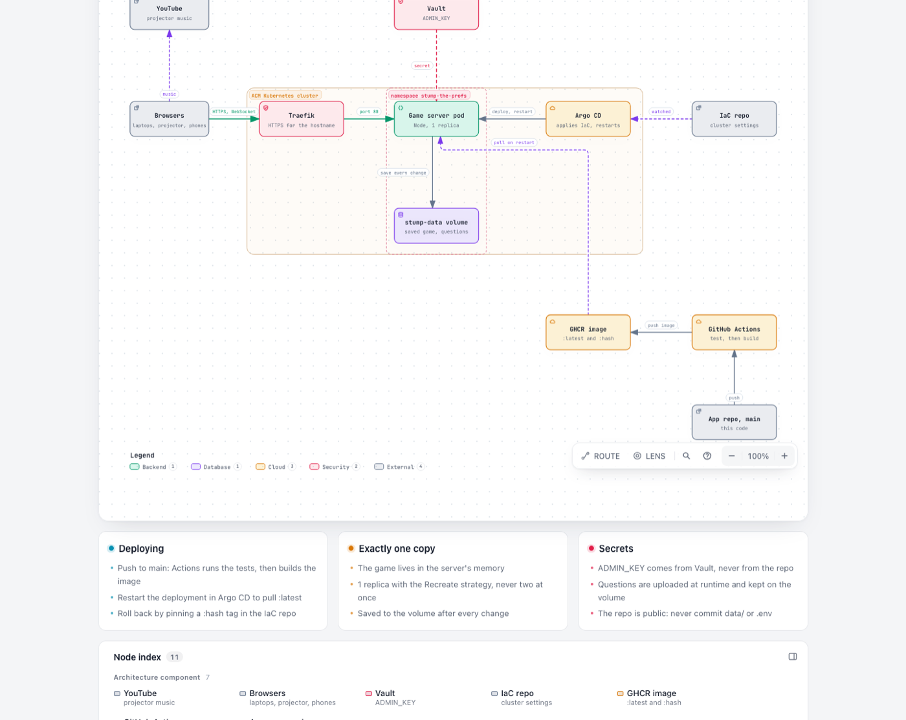
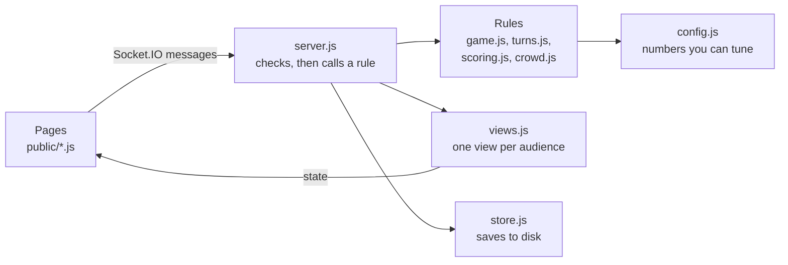
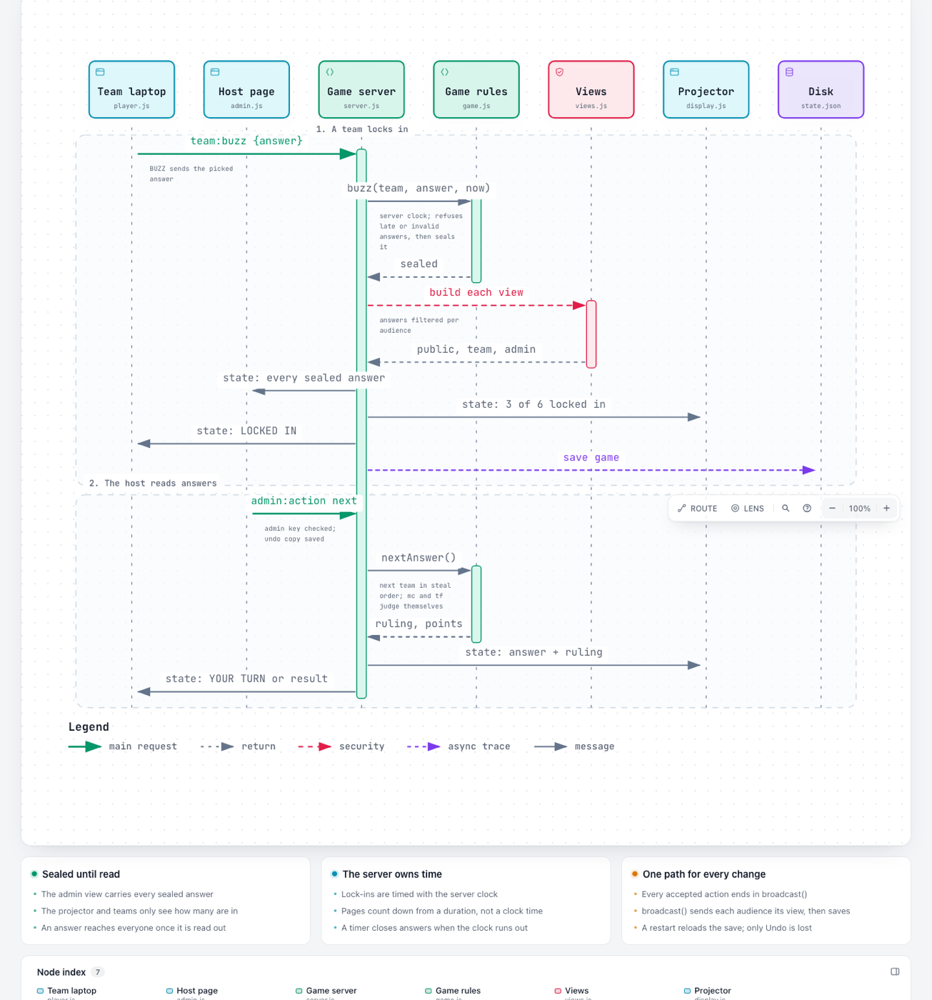
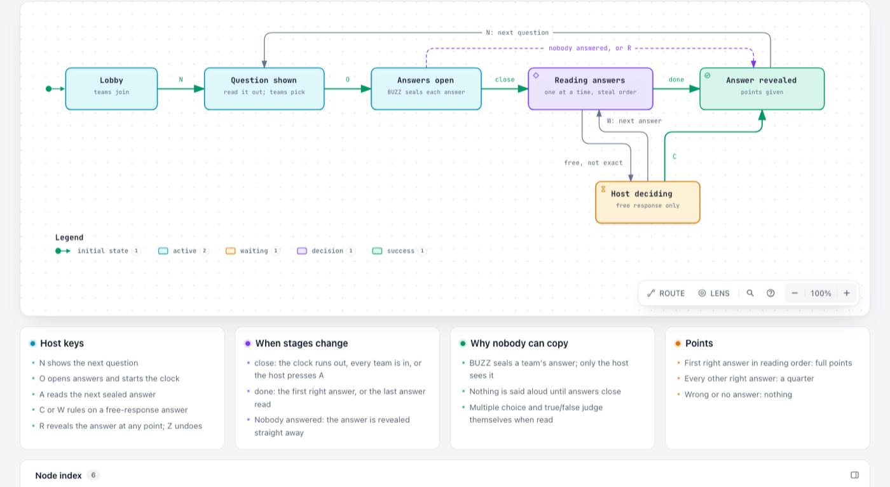

# How the code works

This guide is for developers who want to change the game: fix a bug, add a feature, or change a rule. It assumes you can read JavaScript. For the night itself, see [Running the event](run-the-event.md); for questions and music, see [Before the event](before-the-event.md).

## Words used in this guide

- **Socket.IO:** a library for live two-way messages between the server and browsers. Every click in the game is a Socket.IO message, not a web request.
- **Server-authoritative:** the server decides everything. The pages only draw what the server sends and report what the person did.
- **State:** the one object that holds the whole game: teams, scores, the current question, sealed answers, the crowd and the music settings.
- **View:** the part of the state one kind of screen is allowed to see. The team view, the public view and the admin view are different.
- **Phase:** where the game is: `lobby`, `preview`, `open`, `judging`, `revealed`, or `final` (the results screen at the end).
- **Broadcast:** sending every screen its own view after a change.

## The big picture



([Interactive version](diagrams/system-overview.html): download it and open it in a browser. Click a box to see the code behind it.)

- One Node.js process runs the whole game. It serves the pages with Express and talks to every browser over Socket.IO.
- The game lives in that process's memory. That is why the cluster runs **exactly one copy** (1 replica, with the Recreate strategy so an old and a new copy never overlap).
- After every change the server saves the whole state to a disk volume. A restart reloads it; only Undo history is lost.
- The admin key comes from Vault. Questions are uploaded on the host page and kept on the volume. Neither is ever in this public repo.

## Inside the server



Five rules hold the code together. Keep them when you change things.

1. **The server decides; the pages only draw.** A page never works out a score or a phase. It sends what the person did and redraws from the next `state` message.
2. **Rules are pure functions.** Every function in `game.js` takes the state, changes it, and returns `{ ok: true }` or `{ ok: false, error }`. When it refuses, it changes nothing. Rules know nothing about sockets, browsers or timers, so the tests can call them directly.
3. **`views.js` is the only gate for secrets.** The answer, sealed answers, accepted spellings and rejoin codes are filtered there. Copy fields into a view by name; never spread a whole question or answer object into one. (Uploaded pictures are the one secret served outside the views: `server.js` hands a picture out only while its question is on screen.)
4. **Every change ends in `broadcast()`.** It sends each audience its view, then saves the game. There is no other path to the browsers or the disk.
5. **The server owns time.** Lock-ins are timed with the server's clock. Pages count down from a duration the server sends, so a laptop with a wrong clock still agrees.

## What happens when a team buzzes



([Interactive version](diagrams/buzz-and-read.html))

1. `public/player.js` keeps the picked answer on the laptop. **BUZZ** sends `team:buzz` with that answer.
2. `server.js` finds which team the connection belongs to and calls `buzz()` in `game.js` with the server's time.
3. `buzz()` refuses a late or invalid answer. Otherwise it records the time and seals the answer. If every team is now in, answers close.
4. `broadcast()` builds the views. The admin view gets every sealed answer; the projector and the teams only get how many teams are in.
5. When the host presses **A**, `nextAnswer()` takes the next team in the reading order (`turns.js`: fastest first, then switching sides). Multiple choice and true/false are judged at once; free response waits for `judge()`.

The stages of a question, and which key moves each one on:



## Where things are

| File | What it does |
|---|---|
| `server.js` | Starts Express and Socket.IO, restores the save, checks the admin key, runs each action, keeps Undo, closes answers when the clock runs out, saves after every broadcast. |
| `game.js` | All game rules: teams, phases, sealing answers, reading them out, judging, scoring, host fixes, music settings, and upgrading old saves. |
| `turns.js` | The reading order. Pure, and worked out fresh every time. |
| `scoring.js` | Points, the quarter share, answer clocks, automatic answer checks, and the partial share for "pick all that apply" questions. |
| `crowd.js` | The audience: nicknames, predictions, answer-along and the cheer meter. Nothing is scored; phones are only told whether they were right. |
| `views.js` | The public, team and admin views, and the final results (standings and awards). Secrets stop here. |
| `store.js` | Checks question files and saves the game and uploaded pictures safely (write a temporary file, then rename). |
| `music.js` | Reads and checks YouTube links. |
| `images.js` | Checks question pictures: safe file names, `https://` links, and that an upload really is a PNG, JPEG, GIF or WebP. |
| `config.js` | Every number you can tune, plus settings from the environment. |
| `public/player.*` | The team laptop page. |
| `public/display.*`, `public/music.js` | The projector and phone page, and the projector's YouTube player. |
| `public/admin.*` | The host page. |
| `public/common.js` | Drawing helpers every page uses. |
| `public/tokens.css`, `public/style.css` | The clay design: tokens first, then component styles. Colours and fonts only ever come from tokens. |
| `test/` | Automatic checks, run with `npm test`. |
| `deploy/iac/` | A copy of the cluster settings that live in the IaC repo. |

## Messages between pages and the server

| Message | From | What it does |
|---|---|---|
| `team:register` | Team page | Join with a name and side. |
| `team:rejoin` | Team page | Get back in with a rejoin code (one try a second per connection). |
| `team:buzz` | Team page | Lock in the picked answer. |
| `display:join` | Projector and phones | Receive the public view and the cheer meter. |
| `crowd:join`, `crowd:predict`, `crowd:pick`, `crowd:cheer` | Phones | Crowd play. Cheers are limited to one every 150 ms. |
| `music:status` | Projector | Tells the host page a video could not play. |
| `admin:auth` | Host page | Prove the admin key. |
| `admin:action` | Host page | `show`, `open`, `close`, `next`, `judge`, `reveal`, `results`, `markAnswer`, `adjust`, `kick`, `toggleRegistration`, `loadQuestions`, `reset`, `undo`, `export` and `music`. |
| `state` | Server | The view for that screen, sent after every change. |
| `cheer`, `crowd:me` | Server | The cheer meter (every 250 ms) and each phone's own picks and whether they were right. |
| `team:kicked`, `game:reset` | Server | Tell pages to forget their team or crowd identity. |

## Web requests

Three things use ordinary web requests instead of Socket.IO:

| Request | What it does |
|---|---|
| `GET /healthz` | Says `ok`. Kubernetes uses it to check the server is alive. |
| `POST /admin/images/<name>` | The host page uploads one picture. Needs the admin key in an `x-admin-key` header, checked before the body is read. Up to 5 MB. Socket.IO is not used because its messages are capped at 1 MB. |
| `GET /question-image/<number>/<name>` | One uploaded picture, but only while question `<number>` is on screen and uses that picture. Anything else gets 404, so nobody can peek at later pictures by guessing names. |

Pictures are saved in `data/images/` (set by `IMAGES_PATH`), next to the questions, on the cluster's disk volume.

## Two kinds of multiple choice

A multiple choice question's `answer` is either one choice number or a list of them.

- **One number:** teams pick one choice. Right or wrong.
- **A list ("pick all that apply"):** teams lock in a sorted list of choices. `rightShare()` in `scoring.js` gives the share of the right choices found, or 0 if any picked choice is wrong. A share of 1 is a normal right answer. Between 0 and 1 is **partly right**: `buzz()` stores it as `partial` on the sealed answer. It is read out like a wrong answer (the question goes on) but does not count as wrong in the stats. When the question ends, `settleLockIns()` pays `partialPoints()`: the "also right" points times the share.

Views send `question.multiple: true` so the pages allow several picks; they never say which choices are right before the reveal. The crowd still picks one choice; any right one scores.

## Run it on your computer

You need Node.js 24.

```
npm install
cp .env.example .env    # then put a password after ADMIN_KEY=
npm run dev             # restarts when you save a file
```

Open `http://localhost:3000`; the host page is `/admin.html`. Open `player.html` in several private windows to play as several teams. Delete `data/state.json` to start a fresh game. Put a questions file at `data/questions.json` to load it on a fresh start; `data/` is never committed.

Run `npm test` before every push. All tests should pass.

## Making common changes

**Change a number** (points, clocks, the quarter share): edit `config.js`. Each setting has a comment.

**Add a field to questions:**
1. Check it in `validateQuestions()` in `store.js`, with a clear error message.
2. If players may see it, copy it by name in `questionFor()` in `views.js`.
3. Add tests for both: a valid and an invalid file, and that the field does or does not reach the team view.

**Add a host action:**
1. Write the rule in `game.js`: return `{ ok, error }`, and change nothing when refusing.
2. Add it to `adminActions` in `server.js`. It then gets Undo and a broadcast for free.
3. Add a button (and maybe a key) in `public/admin.html` and `public/admin.js`.
4. Test the rule in `test/game.test.js`.

**Show something new on a screen:** add it to the right view in `views.js`, then draw it in that page's `socket.on("state")` handler. Use `textContent`, never `innerHTML`, for anything a person typed.

## Updating the live site

1. Push to `main`. GitHub Actions runs the tests, then builds the image and tags it `latest` and with the short commit ID.
2. When both jobs are green, open Argo CD (`https://cd.acmuic.org`), find **stump-the-profs**, click the `stump` deployment, then **⋮** and **Restart**. The new image starts in under a minute.
3. Hard refresh the site to check.

**Rolling back:** in the IaC repo, set the image in `kubernetes/argocd/stacks/stump-the-profs/stump-the-profs.yml` to a known-good short commit ID instead of `latest`, and merge it. Set it back to `latest` when the fix is in.

**Never push to `main` on event day.** Any restart would load the newest code in the middle of the game.

## Things that are easy to get wrong

- **Never commit `data/` or `.env`.** The repo is public; `data/` holds the real questions and answers.
- **Keep one copy of the server.** Two copies would each hold their own game.
- **Old saves:** the live server may hold a game saved by an older version. `upgradeState()` in `game.js` converts it on start-up; extend it when you change the state's shape.
- **The `hidden` attribute:** `style.css` forces `[hidden] { display: none }`, because a `display: flex` rule would otherwise show hidden elements.
- **Sound on the projector:** browsers block sound until someone clicks the page once. That is expected.
- **Never allow SVG pictures.** An SVG can hold a script. Served from this site, it could read the admin key that the host page keeps in the browser. `images.js` checks the first bytes of every upload, so a renamed file is refused too.
- **Pictures are not in Export backup.** They are files on the volume, not part of the game state.
- **Diagrams in this guide** were made with the archify skill and checked against the code at the time. If you change how buzzing or reading works, update them or remove them.
