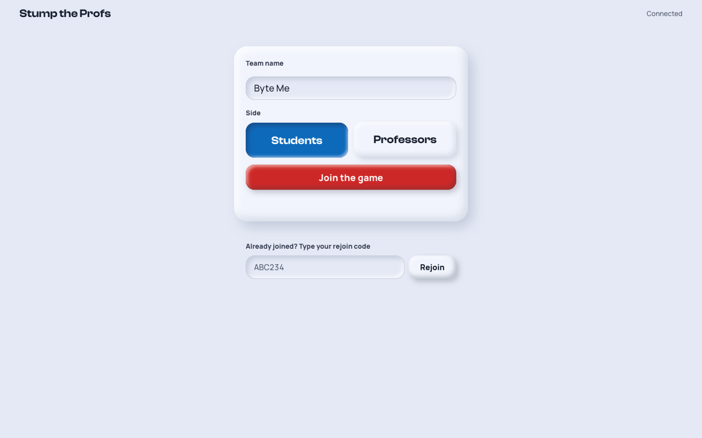
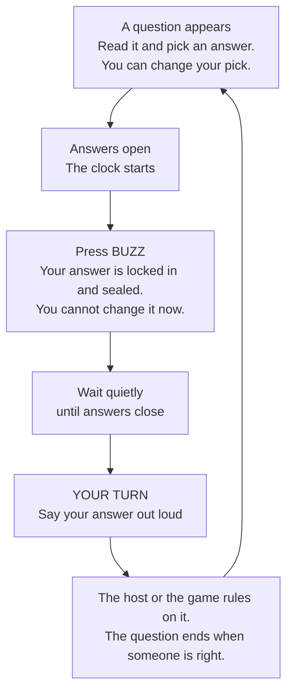
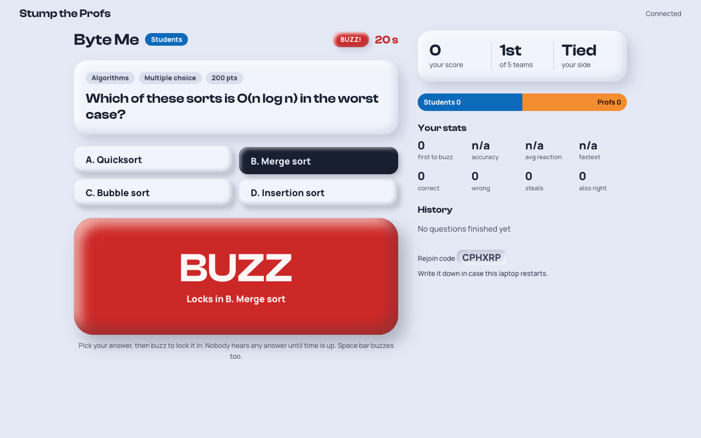
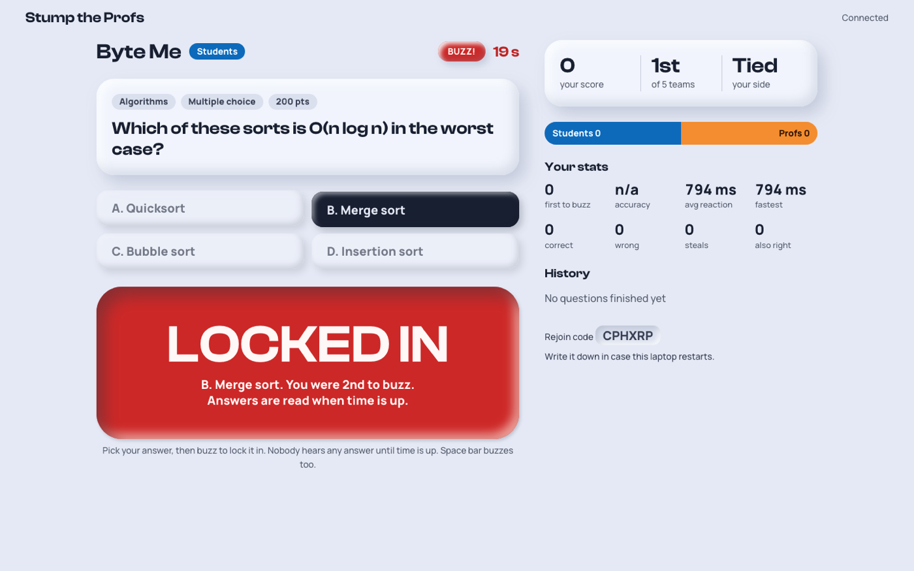
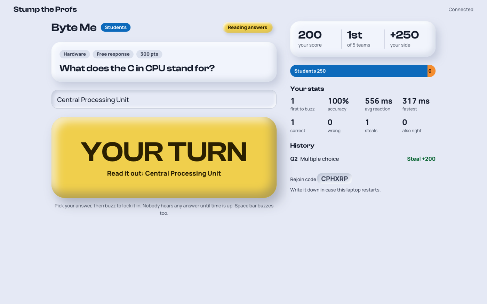
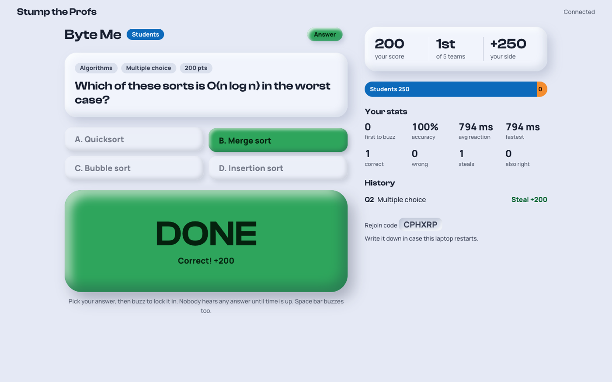
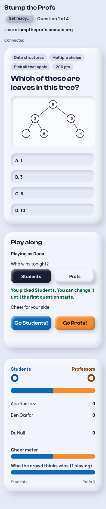

# How to play Stump the Profs

Students and professors race to answer computer science questions. Teams play on laptops; everyone else plays along on their phones. This page explains both.

**The site:** https://stumptheprofs.acmuic.org

## The rules in short

- Every question has a clock: 30 seconds for typed answers, 20 for multiple choice, 15 for true or false.
- Pick your answer, then press **BUZZ**. That locks it in, sealed. Nobody but the host can see it, and you cannot change it.
- When answers close, the host reads them out one by one: the fastest team first, then switching between Students and Professors.
- The first right answer gets full points (300 typed, 200 multiple choice, 100 true or false). Every other right answer gets a quarter.
- A wrong answer, or no answer, costs nothing. Always lock in your best guess.

## For teams

Each team plays on one laptop. Open **https://stumptheprofs.acmuic.org**, click **Players**, type a team name, pick Students or Professors, and click **Join the game**. Write down the **rejoin code** shown at the bottom right of your screen once you are in.

This is what you do for every question.

1. **A question appears.** Read it. Click the answer you think is right (or type it, for free response). You can change your pick as often as you like until you press BUZZ.
2. **Answers open** and a clock starts on your screen. The button now says **BUZZ**.
3. **Press BUZZ** to lock in your pick. Your answer is sealed: only the host can see it. You cannot change it. The faster you buzz, the earlier your answer is read.

   | Picking an answer | After pressing BUZZ |
   |---|---|
   |  |  |

4. **Stay quiet** until answers close. Saying your answer early only helps the other teams.
5. **When the button says YOUR TURN,** say your answer out loud. The screen shows it so you read it exactly as you locked it in.

   

6. **The result shows on the button.** Your score, rank and stats update on the right.

   

**If you do not buzz before the clock runs out,** you have no answer for that question and score nothing. A wrong answer also scores nothing; it never takes points away. So it is always worth locking in your best guess.

### What the big button means

| Button says | Colour | What it means |
|---|---|---|
| **WAIT** | Grey | No question yet, or the question is showing but answers are not open. You can already pick. |
| **PICK** | Grey | Answers are open. Choose an answer first. |
| **BUZZ** | Red | Press it to lock in the answer shown under the word. |
| **TIME** | Grey | The clock ran out before you buzzed. |
| **LOCKED IN** | Red, pressed in | Your answer is sealed. While answers are open it shows your buzz order ("You were 2nd to buzz"). Once reading starts it shows your place ("Yours is read 3rd"). |
| **YOUR TURN** | Yellow | Say your answer out loud now. |
| **WRONG** | Grey, pressed in | Your answer was read and it was not right. |
| **NO ANSWER** | Grey, pressed in | You did not lock in before answers closed. |
| **DONE** | Green | The question is over. It says how you did: "Correct!", "Also right!", who got it, or "The host will mark your answer" (free response). |

### Keyboard shortcuts

| Key | Does |
|---|---|
| **A** to **F** | Pick choice A to F (multiple choice) |
| **T** / **F** | Pick True / False |
| **Space** | BUZZ |
| **Enter** | BUZZ, while typing a free-response answer |

### The rest of your screen

- **Score, rank and side:** your points, your place among all teams, and how far your side (Students or Professors) is ahead or behind.
- **The bar:** Students' total against Professors' total.
- **Your stats:** how often you were first to buzz, accuracy, average and fastest reaction time (from answers opening to your buzz), right and wrong answers, steals (winning after another team was wrong) and "also right" answers.
- **History:** how you did on each finished question.
- **Rejoin code:** bottom right. Write it down. On another laptop, type it in the box under **Join the game** to get back in.

## For the audience

Anyone can play along on a phone. Open the home page, tap **Display**, type a nickname (up to 20 characters, not already taken) and tap **Join**. The phone shows the same question, timer and scores as the projector, with a **Play along** box.

For every question:

1. **Predict who gets it** when the question appears: **Students**, **Profs** or **Nobody**. You can change your mind until answers open. Right predictions score 10 points.
2. **Answer along** while the teams are answering (multiple choice and true/false only). Tap one answer. You cannot change it. It closes when the teams' answers close. Right answers score 10 points.
3. **Watch the answers** being read out on the projector or your phone.
4. **See how you did.** After the answer is shown, the box says "Prediction right!", "Answer right!" or that you missed.

At any time:

- **Cheer** with the **Go Students!** and **Go Profs!** buttons. The cheer meter on the projector shows which side is loudest right now; it fades when people stop.
- **Your score and rank** among the crowd are at the top of the **Play along** box. The top 5 show on the projector.

The phone remembers you. If the page closes, open it again and you are back in. If the host resets the game, everyone joins again.

Questions during the game? Ask one of the hosts.
