# Running Stump the Profs on the night

This guide is for the people running the game during the event. You do not need to know any code. Keep it open on the host laptop.

## The four screens

Everything happens at **https://stumptheprofs.acmuic.org**. Each person opens a different page.

| Who | Page | What it is for |
|---|---|---|
| The host | `/admin.html` | Runs the game: shows questions, reads answers, fixes scores. Needs the admin key. |
| The projector | `/display.html?projector` | The big screen: question, timer, answers, scores, crowd. |
| Each team | `/player.html` | The team's buzzer, answer pad, score and stats. One laptop per team. |
| The audience | The home page, then **Display** | Play along on a phone: predict, answer, cheer. |

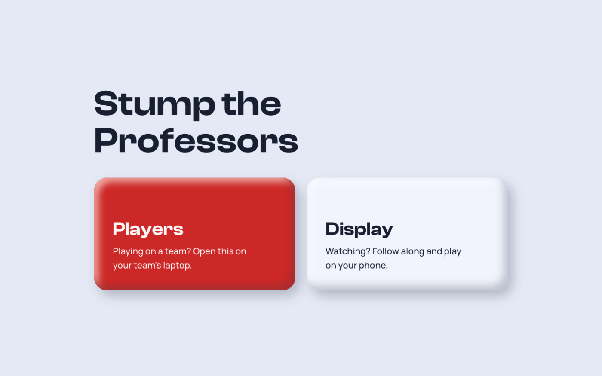

## Words used in this guide

- **Admin key:** the password for the host page. It is stored in Vault (the ACM password store). Ask whoever set up the event for it. Never post it in a chat or on the screen.
- **Lock in:** a team picks an answer and presses **BUZZ**. That sends the answer and seals it.
- **Sealed answer:** an answer that only the host can see until it is read out. Nobody can copy it.
- **Reading order:** the order the sealed answers are read. The fastest team goes first. After that it switches between Students and Professors.
- **Rejoin code:** a 6-character code each team gets when it joins. It lets a team get back in from any laptop.

## Before doors open

Do these in order. Allow 30 minutes.

1. **Use UIC Wi-Fi or phone data.** The site does not open on the ACM or Maid Café Wi-Fi yet. (Those networks use their own address book, which is missing this site.)
2. **Check the site is up.** Open `https://stumptheprofs.acmuic.org/healthz`. It should say `ok`.
3. **Log in as host.** Open `/admin.html` and type the admin key. The browser remembers it.

   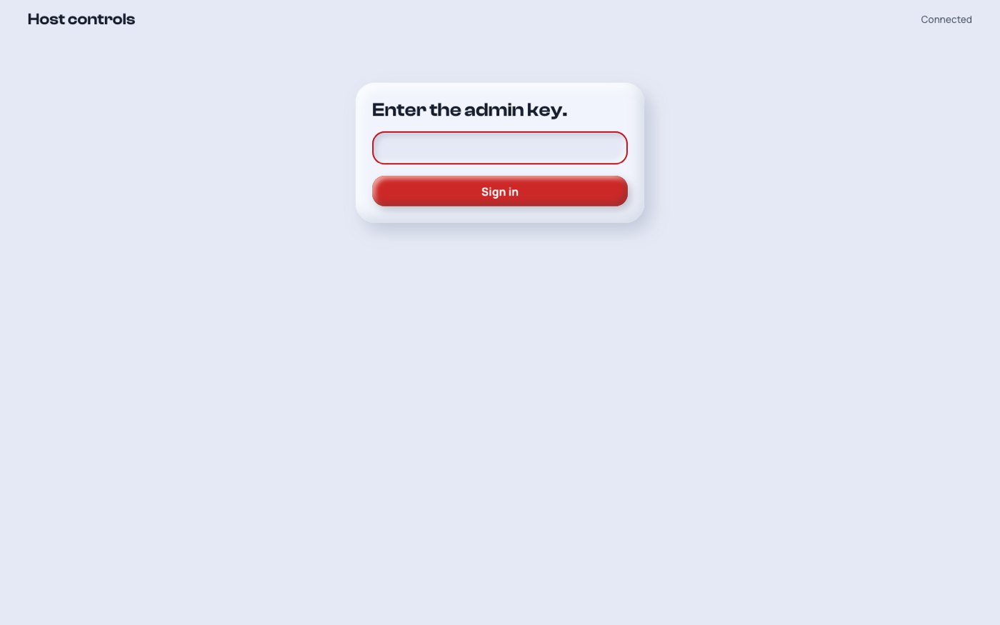

4. **Clear the rehearsal.** If teams or scores from a practice run are showing, click **Export backup** first, then **Reset game…**. Your questions stay.
5. **Check the questions.** The **Questions** list on the right should show the real questions. If it shows the 4 sample questions, see [Before the event](before-the-event.md#put-the-questions-on-the-live-site).
6. **Set up the projector.** On the projector computer, open `/display.html?projector`. Press **F** for full screen. Then click once anywhere on the screen; browsers do not play sound until someone clicks.
7. **Start the music** (optional). In the host page's **Music** box, paste a YouTube link, click **Set**, then **Play**. Use the slider for volume.
8. **Let teams join.** Each team opens `/player.html`, types a team name, picks a side and clicks **Join the game**. Tell every team to **write down their rejoin code** (bottom right of their screen).

   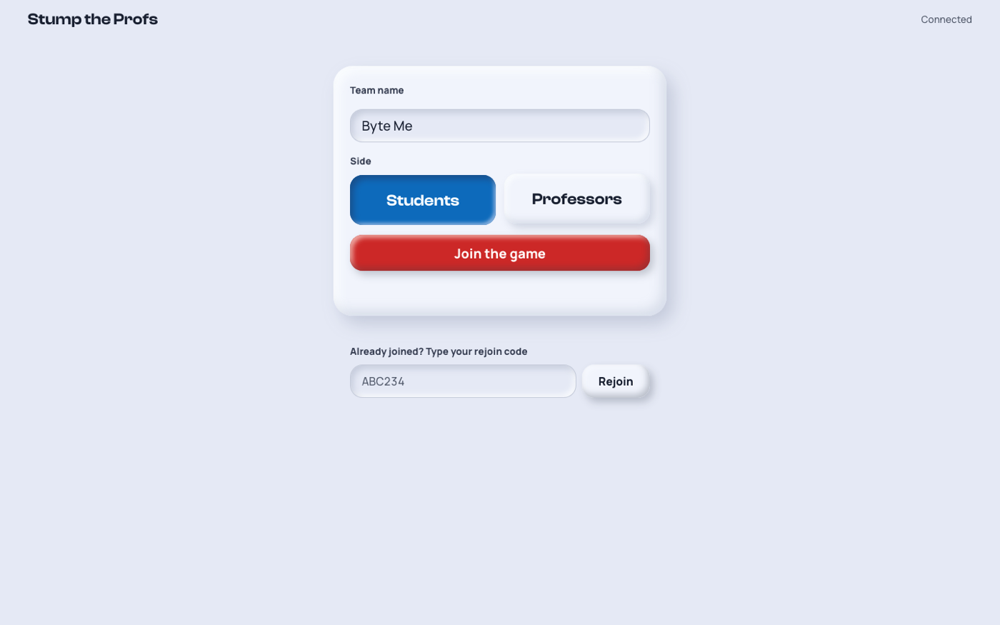

9. **Close registration** when every team is in. Click **Close registration** on the host page. You can reopen it.
10. **Tell the room the rules.** Read out [the short script](#read-this-to-the-room).

The projector before the first question:

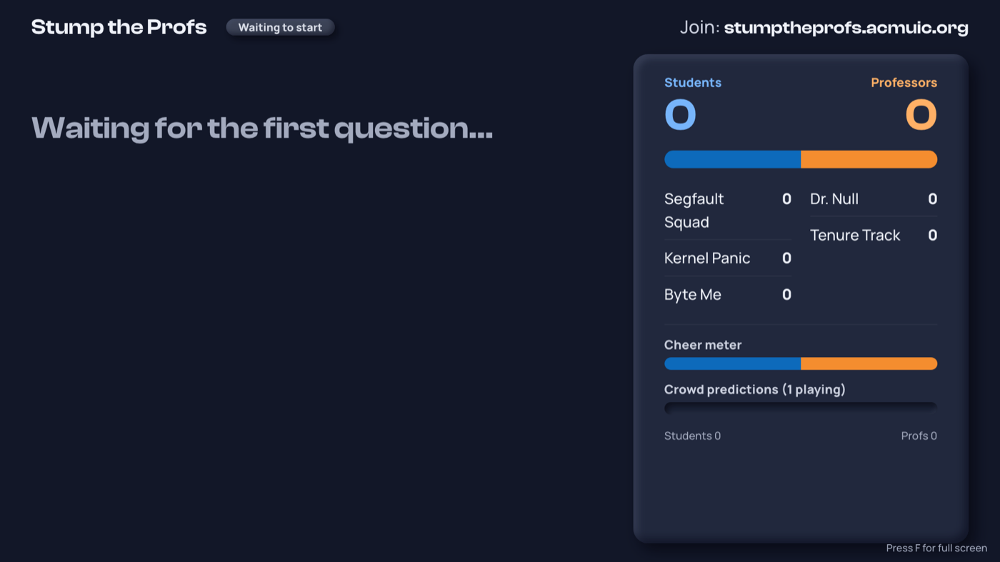

## How one question works

This section is the host's side. For what teams and the crowd do, see [What teams do](#what-teams-do) and [What the crowd does](#what-the-crowd-does).

The host does everything with single keys. You can also click the buttons.

| Key | Button | What it does |
|---|---|---|
| **N** | Show next question | Puts the next question on every screen. Teams can read it and pick an answer, but cannot lock in yet. |
| **O** | Open answers | Starts the clock. Teams can now lock in. |
| **A** | Read next answer | Stops taking answers (if still open) and reads the next sealed answer. |
| **C** | Correct | The answer being read is right. |
| **W** | Wrong | The answer being read is wrong. |
| **R** | Reveal answer | Ends the question now and shows the answer. |
| **Z** | Undo | Takes back your last host action. |

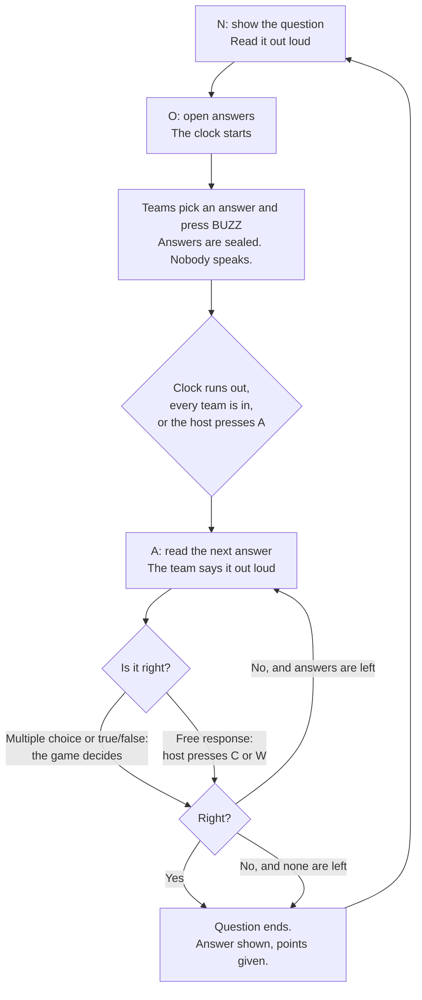

### Step by step

1. **Press N.** Read the question out loud. Teams can already pick an answer.

   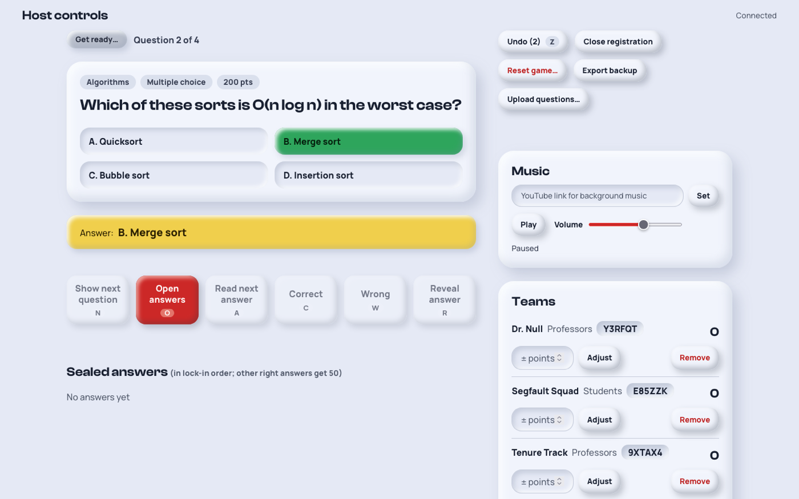

2. **Press O.** The clock starts: 30 seconds for free response, 20 for multiple choice, 15 for true/false (unless the question sets its own). Teams pick an answer and press **BUZZ**. The projector shows how many teams are in, but never what they answered.

   | A team picks B | Then presses BUZZ |
   |---|---|
   | 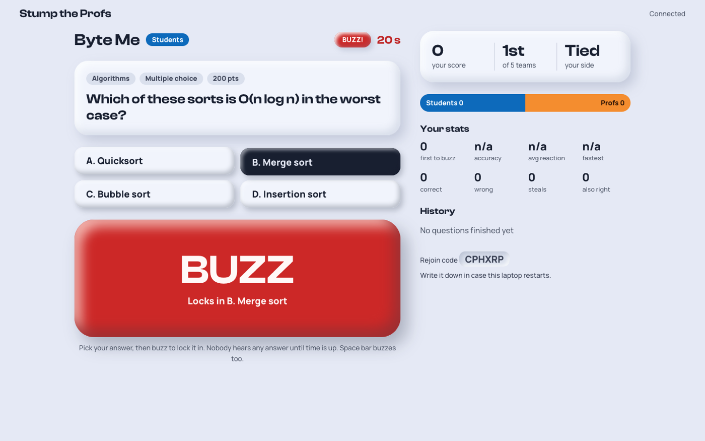 | 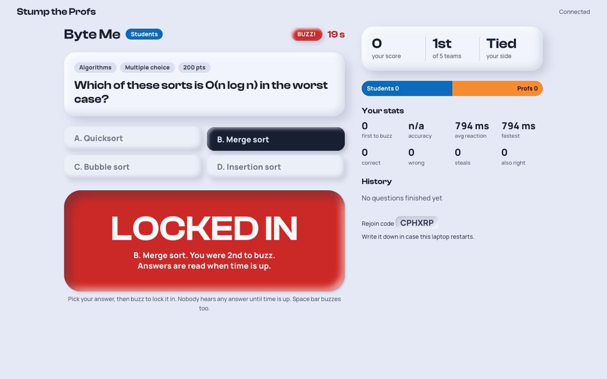 |

   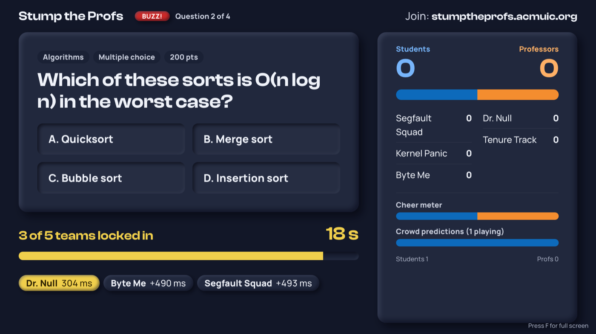

   Your host page shows every sealed answer as it arrives. Keep this screen away from the teams.

   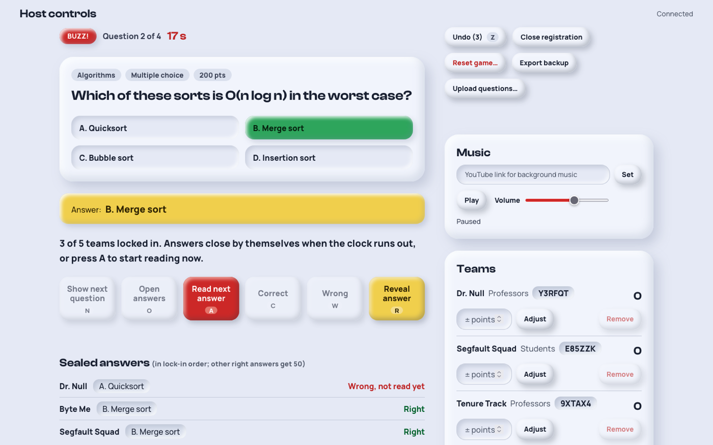

3. **Wait.** Answers close on their own when the clock hits zero or when every team is in. You can press **A** to close them early.
4. **Press A** to read the first answer. That team says its answer out loud. It cannot change it; it was sealed before anyone spoke.
   - Multiple choice and true/false are marked right or wrong straight away.
   - Free response shows "Host is deciding". Press **C** if it is right or **W** if it is wrong. The correct answer is in the yellow box on your page.

   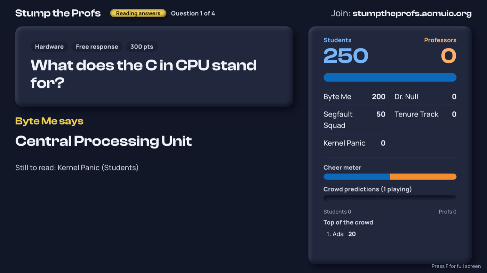

   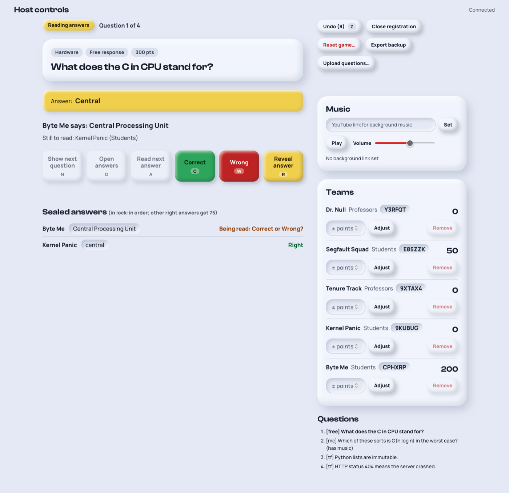

5. **Keep pressing A** until an answer is right or every answer has been read. A wrong answer moves on to the next team in the reading order.

   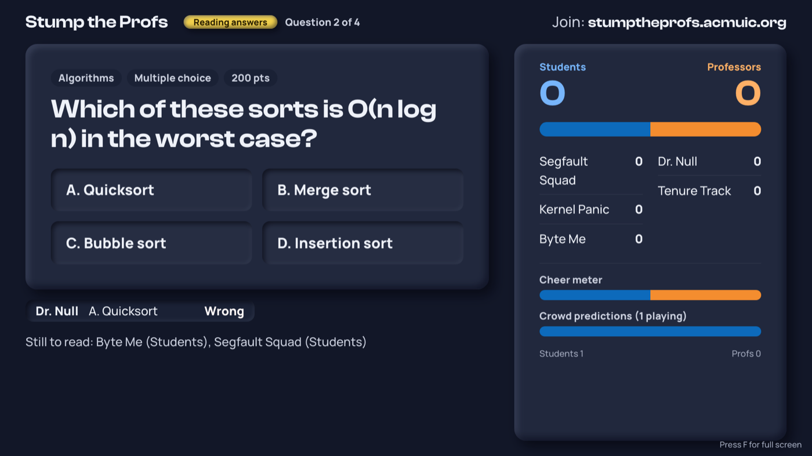

6. The question ends. The projector shows the answer, who won and who else was right.

   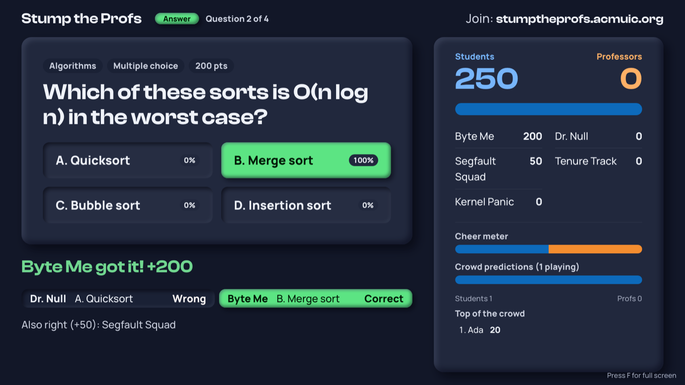

7. **Free response only:** answers that were never read out may still be right. In the **Sealed answers** list, click **Right** or **Wrong** next to each one marked "Needs marking". Clicking again is safe.
8. **Press N** for the next question.

## Scoring

| Question type | First right answer | Any other right answer |
|---|---|---|
| Free response | 300 | 75 |
| Multiple choice | 200 | 50 |
| True / false | 100 | 25 |

- "First right answer" means the first right one **in the reading order**, not the fastest overall.
- A question can be worth a different amount if its file says so.
- A wrong answer costs nothing.
- The side totals (Students against Professors) add up every team on that side.

## What teams do

Each team plays on one laptop at `/player.html`. This is their loop for every question.

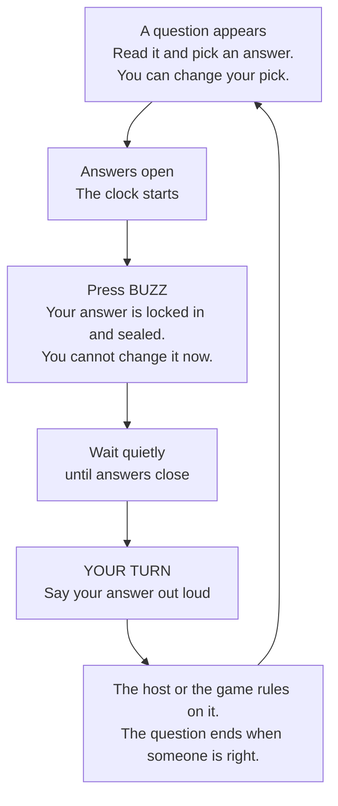

1. **A question appears.** Read it. Click the answer you think is right (or type it, for free response). You can change your pick as often as you like until you press BUZZ.
2. **Answers open** and a clock starts on your screen. The button now says **BUZZ**.
3. **Press BUZZ** to lock in your pick. Your answer is sealed: only the host can see it. You cannot change it. The faster you buzz, the earlier your answer is read.

   | Picking an answer | After pressing BUZZ |
   |---|---|
   |  |  |

4. **Stay quiet** until answers close. Saying your answer early only helps the other teams.
5. **When the button says YOUR TURN,** say your answer out loud. The screen shows it so you read it exactly as you locked it in.

   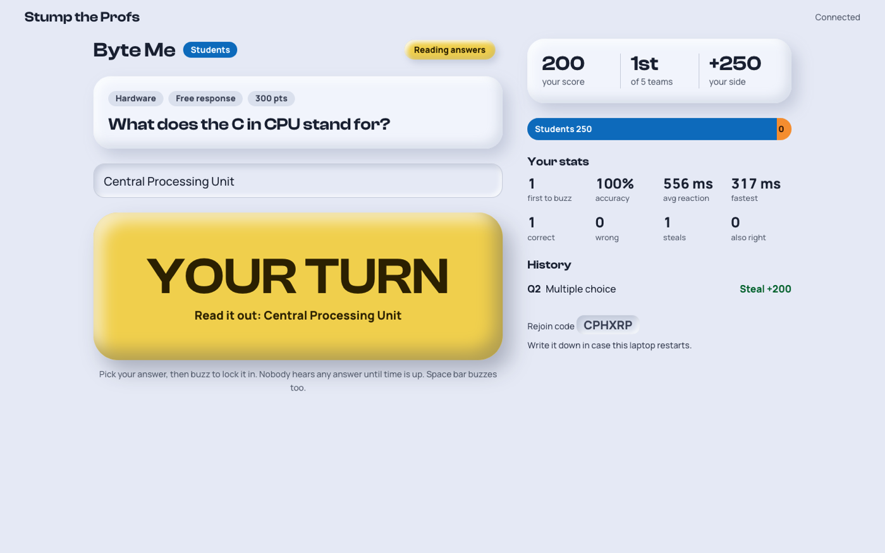

6. **The result shows on the button.** Your score, rank and stats update on the right.

   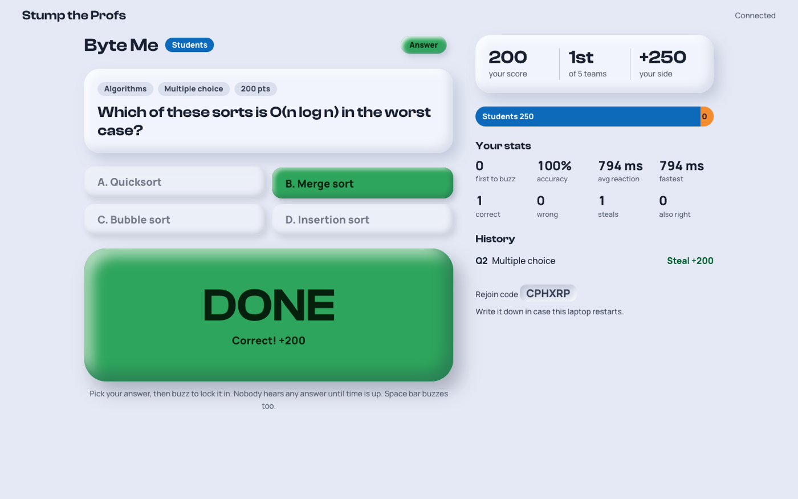

**If you do not buzz before the clock runs out,** you have no answer for that question and score nothing. A wrong answer also scores nothing; it never takes points away. So it is always worth locking in your best guess.

### What the big button means

| Button says | Colour | What it means |
|---|---|---|
| **WAIT** | Grey | No question yet, or the question is showing but answers are not open. You can already pick. |
| **PICK** | Grey | Answers are open. Choose an answer first. |
| **BUZZ** | Red | Press it to lock in the answer shown under the word. |
| **TIME** | Grey | The clock ran out before you buzzed. |
| **LOCKED IN** | Red, pressed in | Your answer is sealed. While answers are open it shows your buzz order ("You were 2nd to buzz"). Once reading starts it shows your place ("Yours is read 3rd"). |
| **YOUR TURN** | Yellow | Say your answer out loud now. |
| **WRONG** | Grey, pressed in | Your answer was read and it was not right. |
| **NO ANSWER** | Grey, pressed in | You did not lock in before answers closed. |
| **DONE** | Green | The question is over. It says how you did: "Correct!", "Also right!", who got it, or "The host will mark your answer" (free response). |

### Keyboard shortcuts for teams

| Key | Does |
|---|---|
| **A** to **F** | Pick choice A to F (multiple choice) |
| **T** / **F** | Pick True / False |
| **Space** | BUZZ |
| **Enter** | BUZZ, while typing a free-response answer |

### The rest of the team screen

- **Score, rank and side:** your points, your place among all teams, and how far your side (Students or Professors) is ahead or behind.
- **The bar:** Students' total against Professors' total.
- **Your stats:** how often you were first to buzz, accuracy, average and fastest reaction time (from answers opening to your buzz), right and wrong answers, steals (winning after another team was wrong) and "also right" answers.
- **History:** how you did on each finished question.
- **Rejoin code:** bottom right. Write it down. On another laptop, type it in the box under **Join the game** to get back in.

## What the crowd does

Anyone can play along on a phone. Open the home page, tap **Display**, type a nickname (up to 20 characters, not already taken) and tap **Join**. The phone shows the same question, timer and scores as the projector, with a **Play along** box.

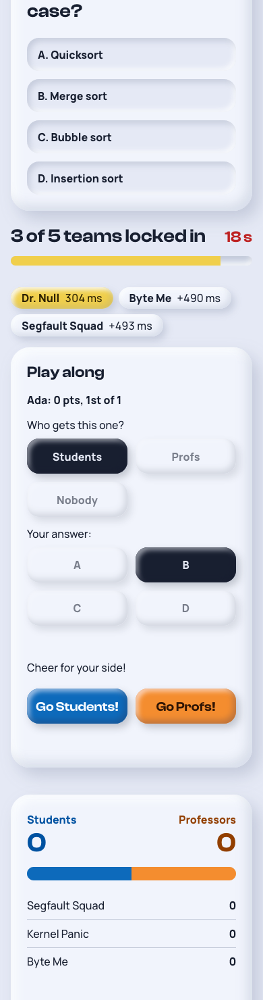

For every question:

1. **Predict who gets it** when the question appears: **Students**, **Profs** or **Nobody**. You can change your mind until answers open. Right predictions score 10 points.
2. **Answer along** while the teams are answering (multiple choice and true/false only). Tap one answer. You cannot change it. It closes when the teams' answers close. Right answers score 10 points.
3. **Watch the answers** being read out on the projector or your phone.
4. **See how you did.** After the answer is shown, the box says "Prediction right!", "Answer right!" or that you missed.

At any time:

- **Cheer** with the **Go Students!** and **Go Profs!** buttons. The cheer meter on the projector shows which side is loudest right now; it fades when people stop.
- **Your score and rank** among the crowd are at the top of the **Play along** box. The top 5 show on the projector.

The phone remembers you. If the page closes, open it again and you are back in. If the host resets the game, everyone joins again.

## Read this to the room

Before the first question, the host can read this out:

> Teams: when a question appears, pick your answer on your laptop. When answers open, press BUZZ to lock it in. Once it is locked, nobody can see it but me, and you cannot change it. The faster you buzz, the earlier you are read. Stay quiet until answers close. When your screen says YOUR TURN, say your answer out loud. The first right answer gets full points; every other right answer gets a quarter. Wrong answers cost nothing, so always lock something in.
>
> Everyone else: open stumptheprofs.acmuic.org on your phone, tap Display, and join with a nickname. Predict who gets each question, answer along, and cheer for your side.

## When something goes wrong

| Problem | What to do |
|---|---|
| A team's laptop refreshed, closed or restarted | Open `/player.html` again. In the same browser it rejoins by itself. On another laptop, type the rejoin code in the box under **Join the game** and click **Rejoin**. |
| A team lost its rejoin code | The **Teams** list on the host page shows every code. Read it to them quietly. |
| You pressed the wrong key | Press **Z** (Undo). It can step back up to 30 actions. |
| You marked a free-response answer wrong by mistake | If the question has not ended, press **Z**. If it has, use **Adjust** on that team: type the points (for example `300` or `-300`) and click **Adjust**. |
| A score is wrong for any other reason | Use **Adjust** on that team. It accepts up to 1000 points at a time, plus or minus. |
| A team needs to leave | Click **Remove** next to it, between questions (not while answers are open or being read). |
| A late team wants to join | Click **Reopen registration**, let them join, then close it again. |
| The projector says "Reconnecting…" | Wait 10 seconds; it reconnects by itself. If not, refresh the page and click once for sound. |
| No music | Click once on the projector screen. Check the **Music** box on the host page: it should say "Playing". If it shows "Projector: …", that video cannot be played outside YouTube; use a different link. |
| The site is down for everyone | Someone with Argo CD access (the ACM deploy dashboard at `https://cd.acmuic.org`) clicks **Restart** on the `stump` deployment. The game is saved after every change, so it comes back where it was. Undo history is lost. |
| You need to start over | **Export backup**, then **Reset game…**. Undo can bring the old game back if you click it straight away. |

## After the event

1. Click **Export backup** on the host page. Keep the file; it has every team, score and answer history.
2. Pause the music.
3. **Do not change the code on event day.** The live site always runs the newest version of the code, so a change could appear in the middle of the game.

## One-page reference

| Key | Action |
|---|---|
| **N** | Show next question |
| **O** | Open answers (starts the clock) |
| **A** | Read next answer |
| **C** / **W** | Correct / Wrong (free response) |
| **R** | Reveal the answer now |
| **Z** | Undo |
| **F** (on the projector) | Full screen |
